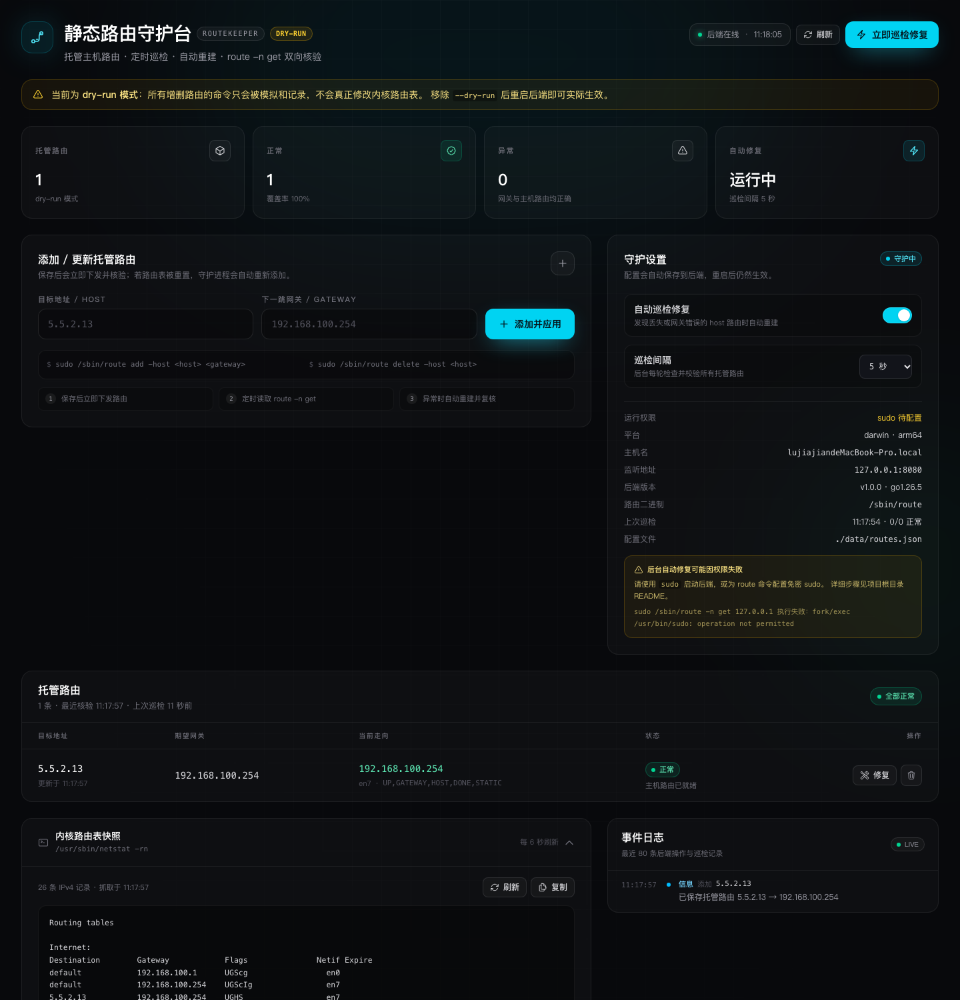

# RouteKeeper · 静态路由守护台

用 **Go + Gin** 写后端、**Next.js 16** 写前端的静态主机路由管理工具，解决 macOS / Linux 上手工维护 host 路由容易被系统重置的问题。



你原来需要手动敲的这些命令：

```bash
sudo route delete -host 5.5.2.13
sudo route add -host 5.5.2.13 192.168.100.254
route -n get 5.5.2.13
netstat -rn
```

现在都可以在网页上完成，并且后端会定时巡检、发现路由丢失或网关错误时自动重建。

---

## 功能

- **托管路由**：保存 `目标 IP → 下一跳网关`，持久化在 JSON 文件里，重启不丢。
- **定时巡检**：默认每 5 秒执行一次 `route -n get`（Linux 为 `ip route get`），确认目标是否命中 **主机路由** 且网关正确。
- **自动修复**：缺失、网关不符、被系统重置时，自动执行删除 + 添加 + 再次核验；可在页面上随时暂停。
- **一键操作**：添加 / 更新、立即修复、删除、立即巡检。
- **路由表快照**：页面上直接查看 `netstat -rn` 原始输出（Linux 没有 netstat 时回退到 `ip route show`），带刷新和复制。
- **事件日志**：记录每次添加、删除、巡检、修复以及实际执行的命令，便于回溯。
- **dry-run 模式**：所有修改路由表的命令只模拟、不执行，适合先验证环境。
- **权限自检**：启动时检测 root / `sudo -n` 是否可用，页面会给出明确提示。
- **安全执行**：所有命令以 argv 数组方式执行，不经过 shell；后端默认只监听 `127.0.0.1`。

## 目录结构

```text
route/
├── be/                                  # Go + Gin 后端
│   ├── main.go                          # flags / 启动 / 优雅退出
│   └── internal/
│       ├── httpapi/                     # REST API、CORS、请求日志
│       ├── healer/                      # 巡检、自动修复、手动 apply/delete
│       ├── routecmd/                    # macOS / Linux 路由命令与输出解析
│       ├── store/                       # JSON 持久化（原子写入）
│       ├── execx/                       # 命令执行封装（sudo / dry-run / 超时）
│       ├── events/                      # 内存事件日志（环形缓冲）
│       ├── validate/                    # IPv4 输入校验
│       └── model/                       # 共享数据结构
├── fe/                                  # Next.js 16 前端
│   ├── app/page.tsx
│   ├── app/layout.tsx
│   ├── app/components/route-dashboard.tsx
│   ├── app/lib/api.ts
│   └── next.config.ts                   # /api/* 反向代理到 Go 后端
└── README.md
```

---

## 快速开始

### 1. 启动后端

```bash
cd be
go build -o route-daemon .
sudo ./route-daemon
```

默认监听 `http://127.0.0.1:8080`，配置写入启动目录下的 `data/routes.json`。

先不修改真实路由表、只看界面和命令？用 dry-run：

```bash
./route-daemon --dry-run
```

#### 选项 A：直接以 root 运行（最简单）

```bash
sudo ./route-daemon
```

#### 选项 B：普通用户 + 免密 sudo（推荐日常使用）

后端使用 `sudo -n` 执行修改命令，不会弹密码，所以需要给 `route` 配置 NOPASSWD：

```bash
# 把 lujiajian 换成你的用户名
sudo visudo -f /etc/sudoers.d/routekeeper
```

写入：

```sudoers
lujiajian ALL=(root) NOPASSWD: /sbin/route
```

保存后确认权限：

```bash
sudo chmod 0440 /etc/sudoers.d/routekeeper
sudo -n /sbin/route -n get 127.0.0.1   # 能输出即配置成功
```

Linux 上路由命令通常是 `ip`，请按 `which ip` 的实际路径配置，例如：

```sudoers
lujiajian ALL=(root) NOPASSWD: /usr/sbin/ip
```

然后普通用户启动：

```bash
./route-daemon
```

> 如果 sudo 配置不生效，页面「运行权限」会显示 **sudo 待配置**，修复失败时也会提示具体原因。

### 2. 启动前端

```bash
cd fe
npm install        # 已经安装过可跳过
npm run dev
```

打开：

- http://localhost:3000
- http://127.0.0.1:3000

前端默认通过 Next.js rewrite 将 `/api/*` 代理到 `http://127.0.0.1:8080`，因此浏览器不需要处理 CORS。

后端不在 8080 时：

```bash
BACKEND_ORIGIN=http://127.0.0.1:9090 npm run dev
```

生产构建：

```bash
cd fe
BACKEND_ORIGIN=http://127.0.0.1:8080 npm run build
npm run start
```

> `BACKEND_ORIGIN` 会被写入构建产物，生产环境请在 `npm run build` 时设置。

---

## 使用说明

1. **添加路由**：填写目标地址（如 `5.5.2.13`）和下一跳网关（如 `192.168.100.254`），点「添加并应用」。保存后会立即执行删除旧主机路由、添加新路由并核验。
2. **查看状态**：列表展示期望网关、当前实际网关、接口、内核 flags。
   - **正常**：命中主机路由且网关一致。
   - **缺失**：没有主机路由（可能只命中了 default 或网段路由）。
   - **网关不符**：存在主机路由但下一跳不是期望值。
   - **检测失败**：命令执行或输出解析失败。
3. **立即修复**：对单条路由重新执行删除 + 添加 + 核验。
4. **立即巡检修复**：对所有托管路由执行一轮检查，异常项自动修复。
5. **守护设置**：
   - 自动巡检修复开关；
   - 巡检间隔（3 / 5 / 10 / 15 / 30 / 60 / 120 秒）；
   - 设置写入后端配置文件，重启后保留。
6. **内核路由表快照**：默认展开，定时刷新 `netstat -rn`，可复制原始内容。
7. **事件日志**：查看每次操作和实际执行的命令；dry-run 下会标明「模拟」。
8. **删除**：二次确认后从托管列表移除，并删除内核中的主机路由，之后不再自动恢复。

---

## 工作原理

### 状态判断

| 平台 | 读取命令 | 判定为「正常」的条件 |
| --- | --- | --- |
| macOS | `route -n get <host>` | flags 包含 `HOST` 且 `gateway` 等于期望网关 |
| Linux | `ip route get <host>` + `ip route show <host>/32` | 存在精确 `/32` 主机路由且 `via` 等于期望网关 |

只看 `route -n get` 的 gateway 不够：当主机路由丢失时，内核会回退到 default 路由，gateway 可能恰好等于期望网关。因此额外校验 `HOST` flag（Linux 校验精确 /32），避免误判为正常。

### 修复流程

```text
巡检 → route -n get 发现异常
     → route delete -host <host>（忽略 “not in table” 等不存在错误）
     → route add -host <host> <gateway>
     → 再次 route -n get 核验
     → 成功写日志；失败记录错误并在页面提示
```

- macOS 命令：`sudo route add -host <host> <gateway>` / `sudo route delete -host <host>`
- Linux 命令：`sudo ip route replace <host>/32 via <gateway>` / `sudo ip route del <host>/32`
- 同一时间只允许一个修改操作（互斥锁），巡检和手动修复不会互相踩踏。
- 一次巡检发现多条异常时会额外记录「疑似路由表被重置」警告。

### 配置文件

`data/routes.json`：

```json
{
  "settings": {
    "autoHeal": true,
    "intervalSeconds": 5
  },
  "routes": [
    {
      "host": "5.5.2.13",
      "gateway": "192.168.100.254",
      "createdAt": "2026-11-06T03:04:26Z",
      "updatedAt": "2026-11-06T03:04:26Z"
    }
  ]
}
```

采用「临时文件 + rename」原子写入，避免进程中断导致配置损坏。

---

## 后端配置项

| 参数 | 环境变量 | 默认值 | 说明 |
| --- | --- | --- | --- |
| `-listen` | `ROUTE_LISTEN` | `127.0.0.1:8080` | HTTP 监听地址 |
| `-store` | `ROUTE_STORE` | `./data/routes.json` | 托管配置持久化路径 |
| `-dry-run` | `ROUTE_DRY_RUN` | `false` | 只模拟修改命令 |
| `-sudo` | `ROUTE_USE_SUDO` | root 时 false，否则 true | 使用 `sudo -n` 执行 |
| `-auto-heal` | `ROUTE_AUTO_HEAL` | `true` | 首次创建配置时的默认值 |
| `-interval` | `ROUTE_INTERVAL` | `5` | 首次创建配置时的默认巡检秒数 |
| `-cors-origin` | `ROUTE_CORS_ORIGIN` | `http://localhost:3000,http://127.0.0.1:3000` | 允许跨域的来源 |

> `-auto-heal` / `-interval` 只在配置文件不存在时作为初始值；之后以页面设置（持久化）为准。想恢复默认可删除 `data/routes.json`。

前端环境变量：

| 变量 | 默认值 | 说明 |
| --- | --- | --- |
| `BACKEND_ORIGIN` | `http://127.0.0.1:8080` | Next rewrite 的后端地址（构建 / 开发时读取） |
| `NEXT_PUBLIC_API_BASE` | 空（同源 `/api`） | 可选，绕过 Next 代理直连后端；需要后端 CORS |

---

## API

所有接口以 `/api` 开头，返回 JSON。错误响应为 `{ "error": "..." }`。

| 方法 | 路径 | 说明 |
| --- | --- | --- |
| GET | `/api/health` | 健康检查 |
| GET | `/api/system` | 平台、权限、sudo 状态、实际命令、配置路径 |
| GET | `/api/routes` | 托管路由实时状态 + 汇总 + 设置 |
| POST | `/api/routes` | 新增 / 更新：`{"host":"5.5.2.13","gateway":"192.168.100.254"}` |
| DELETE | `/api/routes/:host` | 停止托管并删除主机路由 |
| POST | `/api/routes/:host/apply` | 立即修复单条路由 |
| POST | `/api/reconcile` | 立即巡检并修复全部 |
| GET | `/api/route-table` | `netstat -rn` 原始输出 + 解析后的 IPv4 条目 |
| GET | `/api/logs?limit=100` | 最新事件（新→旧，最多 500 条） |
| GET | `/api/settings` | 读取守护设置 |
| PATCH | `/api/settings` | 修改设置：`{"autoHeal":true,"intervalSeconds":10}` |

示例：

```bash
curl -s http://127.0.0.1:8080/api/routes | jq
curl -s -X POST http://127.0.0.1:8080/api/routes \
  -H 'Content-Type: application/json' \
  -d '{"host":"5.5.2.13","gateway":"192.168.100.254"}' | jq
curl -s -X POST http://127.0.0.1:8080/api/reconcile | jq
```

`POST /api/routes` 在命令执行失败时返回 **502**，但路由仍会保存在托管列表里（状态显示缺失，页面会提示错误原因），方便修复权限后重试。

---

## 测试与验证

```bash
# 后端单元测试
cd be
go test ./...

# 前端类型检查 / lint / 生产构建
cd fe
npx tsc --noEmit
npm run lint
npm run build
```

已验证：

- macOS `route -n get` 主机路由 / default 回退 / 无路由输出的解析；
- `netstat -rn` BSD 与 Linux 两种列布局解析；
- 添加已存在且正确的路由时不会重复删除/添加；
- dry-run 下添加、修复、删除只产生模拟命令；
- 非 root 且无 sudo 时返回可操作的错误提示；
- 页面添加、修复、删除确认框、自动修复开关、路由表快照、日志均通过 headless Chrome 交互验证。

---

## 常见问题

**1. 页面显示「后端离线」**

后端没启动，或端口 / 代理不一致：

```bash
curl http://127.0.0.1:8080/api/health
```

确认 `BACKEND_ORIGIN` 指向正确地址后重启前端。

**2. 修复失败：`sudo: a password is required`**

后端无法交互式输入密码。请按「选项 A」用 root 启动，或按「选项 B」配置 NOPASSWD 后再启动后端。

**3. 修复失败：`route: must be root to alter routing table`**

普通用户且没有免密 sudo，处理方式同上。

**4. 添加成功但状态一直是「缺失」**

- 网关必须与目标地址可达（同一链路或已有路由可达），macOS 的 `route add -host` 要求网关可解析；
- 用 `netstat -rn` 检查默认路由和网段路由；
- 检查是否有安全软件 / VPN 立即清除了刚添加的路由；
- 查看事件日志里的具体命令和错误。

**5. 路由总是被重置**

保持「自动巡检修复」开启，巡检间隔建议 3–10 秒。macOS 切换网络、VPN 重连、休眠唤醒后可能出现路由表刷新，守护进程会在下一轮巡检中恢复。

**6. 端口被占用**

```bash
lsof -nP -iTCP:8080 -sTCP:LISTEN
```

换端口启动：`./route-daemon --listen 127.0.0.1:9090`，前端用 `BACKEND_ORIGIN` 指向新地址。

**7. 安全提醒**

后端可以修改本机路由表且没有登录鉴权，默认只监听 `127.0.0.1`。不要直接暴露到公网；如需局域网访问，请在前面加带认证的反向代理。

---

## License

仅用于本机路由运维场景，按需修改使用。
